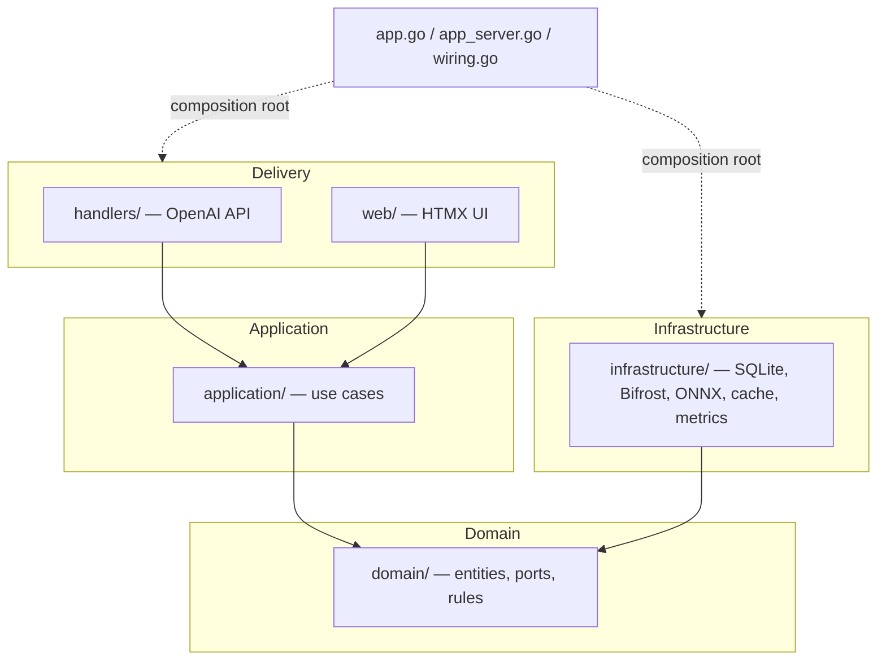

# Bridge Gateway — BifrostAI

[](https://go.dev/)
[](https://github.com/maximhq/bifrost)
[](https://www.docker.com/)
[](https://en.wikipedia.org/wiki/Domain-driven_design)

Bridge Gateway is an OpenAI-compatible API gateway built on **BifrostAI**. It is
written in Go and speaks directly to the Bifrost SDK (no HTTP proxy hop),
routing requests to Ollama, OpenAI, Mistral, Google Gemini, Anthropic, Groq,
Azure, Vertex, OpenRouter, vLLM and any OpenAI-compatible gateway. A small
enrichment pipeline applies the project's system prompt and response settings
before each call.

## Key features

- **Native BifrostAI SDK** — `github.com/maximhq/bifrost/core` is embedded
  directly in the process.
- **Multi-provider abstraction** — one OpenAI-compatible surface for cloud and
  local providers, including private OpenAI-compatible gateways.
- **HTMX web UI** — chat, models, providers, projects, per-project
  configurations and API keys, plus monitoring; server-rendered fragments with
  no external JavaScript bundle.
- **Business enrichment** — system-prompt injection, default model selection,
  strict response formats and generation parameters.
- **Multi-tenant projects** — every configuration belongs to a project; API
  keys are scoped to a project and authenticate `/v1/*` calls against that
  project's active configuration.
- **Local ONNX engines** — embeddings and chat run in-process through a pure-Go
  ONNX Runtime binding. Artifacts live under `models/onnx/` (gitignored) and are
  downloaded on first start unless `ONNX_AUTO_DOWNLOAD=0`.
- **Tier routing and failover** — a local classifier picks `fast`, `balanced`
  or `frontier`; provider saturation moves the request up the ladder and cools
  the failing tier down.
- **In-process monitoring** — traffic, p50/p95/p99 latency, routes, recent
  errors and LLM calls at `/monitoring`, with a JSON snapshot at
  `/monitoring/metrics.json`.
- **SQLite persistence** — a single file, no external database or cache
  service. Legacy JSON stores from `data/` are imported automatically.

## Architecture



Dependencies only point inward:

```
handlers/  web/  ──►  application/  ──►  domain/
infrastructure/  ──────────────────────►  domain/
app.go + wiring.go = composition root (the only place that assembles everything)
```

### Layer rules

- **DIP** — `handlers/ports.go` and `web/ports.go` declare narrow interfaces on
  the consumer side. Concrete use cases are injected by the composition root.
- **ISP** — a port only exposes the methods its consumer uses. `LLMProvider`
  and `StreamingLLMProvider` are separate: streaming is a capability, not an
  obligation.
- **OCP** — repository caches, LLM response caches, the tier router and the
  embedding router wrap ports without modifying them. Enabling or replacing a
  piece is a wiring change.
- **SRP** — entities and rules in `domain/`, orchestration in `application/`,
  technology in `infrastructure/`, presentation in `handlers/` and `web/`, and
  assembly in the composition root.
- **LSP** — every adapter (SQLite, cache, router, Bifrost, ONNX) is
  substitutable for its port and exercised by contract tests.

## Project structure

```
.
├── app.go                  # composition root: stores, services, handlers
├── app_server.go           # HTTP mux, middleware, graceful shutdown
├── main.go                 # flags and the thin startup wrapper
├── wiring.go               # LLM decorators, provider seeding, helpers
├── config.yaml             # models, cache, routing, classifier
├── domain/
│   ├── chat/               # ChatRequest, StreamOptions, EnrichmentService
│   ├── config/             # ChatConfig, validation, JSON Schema builder
│   ├── embedding/          # embedding request/response, choices
│   ├── errs/               # typed error taxonomy and stable codes
│   ├── llm/                # LLMProvider port, result, ProviderError
│   ├── monitoring/         # metrics snapshot types
│   ├── project/            # Project and APIKey entities
│   ├── provider/           # Provider and catalog model entities
│   ├── routing/            # tier rules, failure classification, cooldown keys
│   └── shared/             # cache, ID and repository contracts
├── application/
│   ├── auth/  catalog/  chat/  config/  embedding/
│   ├── entity/             # generic CRUD use case
│   ├── project/            # projects and API keys
│   └── provider/
├── infrastructure/
│   ├── config/  metrics/   # configuration loading, metrics collection
│   ├── *_store.go          # SQLite repositories
│   ├── cached*.go          # repository and LLM caches
│   ├── bifrost*.go         # Bifrost adapters and conversions
│   ├── routing*.go         # tier ladder and failover
│   ├── onnx*.go            # ONNX embeddings, chat and tokenizers
│   └── jsonimport.go       # legacy JSON → SQLite migration
├── handlers/               # OpenAI-compatible HTTP delivery
│   ├── chat/  embeddings/  models/  httpx/
├── web/                    # HTMX controllers per feature
│   ├── templates/  static/
├── docs/                   # embedded OpenAPI document
├── tests/                  # end-to-end delivery tests
└── tools/caps/             # readability cap checker
```

## Getting started

### Requirements

- Go 1.26 or newer.
- Optional: Podman or Docker with Compose for the container workflow.
- Optional: a local Ollama instance for the default model.

### Build and run

```bash
# Build the binary
make build

# Run (port from BRIDGE_PORT in .env, otherwise 8080)
make run

# Or run directly, forcing a port
go run . --config config.yaml --port 4000
```

The startup order is: load `config.yaml`, download missing ONNX artifacts
(non-blocking), open and migrate SQLite, import legacy JSON, build the stores
and use cases, seed the local providers, then serve HTTP with graceful
shutdown.

### Web UI

The HTMX interface is available at `http://localhost:4000` when
`BRIDGE_PORT=4000` (the compose default), or `http://localhost:8080` when no
port is configured.

| Route | Method | Purpose |
|---|---|---|
| `/` | GET | Chat page |
| `/chat/send` | POST | Send a message, return HTMX bubbles |
| `/models` | GET/POST | List or add catalog models |
| `/models/{id}` | DELETE | Remove a catalog model |
| `/providers` | GET/POST | List or create providers |
| `/providers/{id}/edit` | GET | Provider edit fragment |
| `/providers/{id}` | POST/DELETE | Update or delete a provider |
| `/projects` | GET/POST | List or create projects |
| `/projects/{pid}` | GET | Project detail: configurations and keys |
| `/projects/{pid}/configs` | POST | Create a configuration |
| `/projects/{pid}/configs/{cid}` | POST/DELETE | Update or delete a configuration |
| `/projects/{pid}/configs/{cid}/activate` | POST | Activate one configuration per project |
| `/projects/{pid}/configs/{cid}/duplicate` | POST | Duplicate a configuration |
| `/projects/{pid}/configs/{cid}/edit` | GET | Configuration edit fragment |
| `/projects/{pid}/keys` | POST | Create an API key (secret shown once) |
| `/projects/{pid}/keys/{kid}` | DELETE | Revoke an API key |
| `/configs` | GET | Redirect to `/projects` (legacy URL) |
| `/monitoring` | GET | Monitoring dashboard |
| `/monitoring/stats` | GET | Auto-refreshing HTMX fragment |
| `/monitoring/metrics.json` | GET | JSON metrics snapshot |
| `/health/liveness` | GET | Liveness probe |
| `/health/readiness` | GET | Readiness probe |
| `/health/test_connection` | GET | Provider connectivity check |

The UI stays in French; code, comments and developer documentation are in
English.

## Testing and CI

```bash
make test        # fast integration suite: go test ./tests/ -v -count=1
make test-all    # every package: go test ./... -count=1
make test-race   # every package with the race detector
make vet         # go vet ./...
make caps        # file/function/nesting limits
make ci          # fmt + vet + race tests + build
```

The CI workflow (`.github/workflows/ci.yml`) runs formatting, `go vet`, the
readability caps, race tests and a full build on every push and pull request.

### Readability caps

Production Go files must obey:

- at most **300 lines** per file;
- at most **40 lines** per function;
- at most **3 nested control-flow levels**.

`tools/caps` enforces all three. Tests are excluded from the size caps.

## Docker Compose

The gateway is self-contained: SQLite for persistence and an in-memory cache.
`compose.yml` declares a single `gateway` service. The Dockerfile is
multi-stage: a glibc `golang` builder cross-compiles the binary, and a minimal
Debian runtime provides glibc and CA certificates.

> **Why Debian and not `scratch`?** The local ONNX engine loads its runtime with
> `purego`; the no-CGO path imports `libdl.so.2` and `libc.so.6`, so the binary
> is dynamically linked against glibc. SQLite itself uses the pure-Go
> `modernc.org/sqlite` driver, so `CGO_ENABLED=0` is still sufficient.

> **Why a glibc builder and not Alpine?** The Go linker records the ELF
> interpreter of the build host. An Alpine builder records the musl loader,
> which the Debian runtime does not have, and the container fails with
> `exec /bridge-gateway: no such file or directory`. The runtime stage also
> runs the binary once during the build so an interpreter or architecture
> mismatch fails the build instead of the deployment.

```bash
make docker-up      # build and start
make docker-logs    # follow logs
make docker-down    # stop
make docker-reset   # remove volumes and rebuild
```

`compose.yml` publishes `${BRIDGE_PORT:-4000}` on the host and listens on port
8080 inside the container (the existing service contract). It mounts
`config.yaml` read-only and `./data` for SQLite. `.env` is optional (`required: false`), so a clean clone starts without
secrets; set `BIFROST_MASTER_KEY` before exposing the service.

Container networking: `localhost` inside the container is the container
itself. To reach Ollama on the host, compose sets
`OLLAMA_HOST=http://host.docker.internal:11434` and adds the
`host.docker.internal:host-gateway` mapping.

## Render deployment

`render.yaml` describes a single Docker Web Service. It is optional: Render can
auto-detect the `Dockerfile`. The manifest sets `BRIDGE_PORT=4000`,
`ONNX_AUTO_DOWNLOAD=1`, and leaves `BIFROST_MASTER_KEY` as a secret to enter in
the Render UI. Update `OLLAMA_HOST` for the network where Ollama runs.

| Data | Where | How |
|---|---|---|
| SQLite database | `/tmp/bridge-gateway.db` or a persistent disk | `BRIDGE_DB` or `--db` |
| Master key | Render environment | `BIFROST_MASTER_KEY` (never committed) |
| Model settings | `config.yaml` baked into the image | `COPY config.yaml /config.yaml` |
| ONNX artifacts | Downloaded at first start | `ONNX_AUTO_DOWNLOAD=1`, or pre-provision `models/onnx/` |
| Ollama endpoint | Render environment or host DNS | `OLLAMA_HOST` |

`BRIDGE_PORT` controls both the Render service port and the default listen
port. An explicit `--port` flag wins over the environment.

## Persistence and cache

**SQLite.** All persistence goes through one file (`data/bridge.db` by default,
override with `--db`). The schema is created at startup and legacy JSON files
from `data/` are imported idempotently: imported files are renamed to
`.imported`, existing IDs are never overwritten, and re-running the import does
not duplicate records.

**In-memory cache.** Repository reads use a short TTL (15 s by default) so UI
edits become visible quickly. LLM responses use a separate cache (5 min by
default). Both are bounded and swept in-process; disabling either is a
configuration change.

**API keys.** Only the SHA-256 hash of a key is stored. The plaintext secret is
shown once when the key is created.

## Tier routing and failover

Each project configuration carries an optional tier:

```
fast < balanced < frontier
```

When routing is enabled, a small local model classifies the conversation
(`fast` for short factual tasks, `balanced` for multi-step reasoning and code,
`frontier` for ambiguous design work or long contexts). The verdict is applied
only above `min_confidence`; otherwise the active configuration is kept.

On a provider failure, the request moves up one tier and the failed tier is
cooled down for `cooldown`. Failure reasons are classified in
`domain/routing`: rate limits, quota exhaustion, context overflow, transient
outages and rejected credentials are retryable; validation errors and
cancellation are not. Routing is disabled by default in `config.yaml`.

## Monitoring

`/monitoring` renders an HTMX dashboard with traffic, latency percentiles,
route counts, recent errors, Go runtime statistics and LLM calls.
`/monitoring/metrics.json` returns the same snapshot for scraping or uptime
checks. Metrics are collected in-process; no agent is required.

## Local ONNX models

### Embeddings

The default embedding model is `onnx/all-MiniLM-L6-v2`. Other local models are
discovered under `models/onnx/` (a directory containing `model.onnx` and
`vocab.txt`). Requests are routed by the model name:

- `onnx/...` → local ONNX embedder;
- `local/...` → deterministic local embedder (no model files needed);
- anything else → the configured Bifrost provider.

Missing artifacts are downloaded on first start. `ONNX_AUTO_DOWNLOAD=0`
disables all downloads for offline deployments, and `ONNX_RUNTIME_LIB` points
to a non-default ONNX Runtime shared library.

### Chat

The local chat engine uses the SmolLM2 ONNX export under
`models/onnx/chat/smollm2-135m-instruct/` (`model.onnx`, `config.json`,
`generation_config.json`, `tokenizer.json`, `tokenizer_config.json`). It
supports greedy and temperature/top-p sampling, streaming and end-of-sequence
detection. A missing artifact produces an explicit error naming the file.

## API examples

### Chat completion

```bash
curl -X POST 'http://localhost:4000/v1/chat/completions' \
  -H 'Authorization: Bearer sk-bridge-XXXX' \
  -H 'Content-Type: application/json' \
  -d '{
    "model": "gemma4:e4b",
    "messages": [{"role": "user", "content": "Explain goroutines in one paragraph."}]
  }'
```

### Streaming

```bash
curl -N -X POST 'http://localhost:4000/v1/chat/completions' \
  -H 'Authorization: Bearer sk-bridge-XXXX' \
  -H 'Content-Type: application/json' \
  -d '{
    "model": "gemma4:e4b",
    "messages": [{"role": "user", "content": "Count from 1 to 5."}],
    "stream": true,
    "stream_options": {"include_usage": true}
  }'
```

The stream is server-sent events. The final usage frame is separate from the
content frames, matching the OpenAI contract.

### Embeddings

```bash
curl -X POST http://localhost:4000/v1/embeddings \
  -H 'Authorization: Bearer sk-bridge-XXXX' \
  -H 'Content-Type: application/json' \
  -d '{"model":"onnx/all-MiniLM-L6-v2","input":"The cat sleeps on the sofa."}'
```

### Models and errors

```bash
curl http://localhost:4000/v1/models -H 'Authorization: Bearer sk-bridge-XXXX'
```

```json
{"object":"list","data":[{"id":"gemma4:e4b","object":"model","created":1791195330,"owned_by":"ollama"}]}
```

Errors use the OpenAI shape with a stable code:

```json
{"error":{"code":"invalid_api_key","message":"invalid or missing API key","param":null,"type":"authentication_error"}}
```

### OpenAPI

The embedded spec is served at `/openapi.yaml`, and a documentation page is
available at `/docs`.

## Structured output

`response_format` supports:

- `text` — plain text;
- `json_object` — JSON mode without a schema;
- `json_schema` — strict schema, sent as `response_format.json_schema`.

The UI's schema builder produces `additionalProperties: false` and a sorted
`required` list. Strict mode is only advertised when every property is
required, which is what OpenAI enforces.

```json
{
  "model": "gemma4:e4b",
  "messages": [{"role": "user", "content": "Return a person."}],
  "response_format": {
    "type": "json_schema",
    "json_schema": {
      "name": "person",
      "strict": true,
      "schema": {
        "type": "object",
        "properties": {"name": {"type": "string"}},
        "required": ["name"],
        "additionalProperties": false
      }
    }
  }
}
```

## Provider configuration

Providers are stored in SQLite and can be managed from `/providers`. A provider
has a name, a default base URL and an optional default API key. API keys may be
environment placeholders:

- `{env:VAR}`
- `env:VAR`
- `${VAR}`
- `$VAR`

Configuration forms autofill the provider's URL and key, and the API key can be
overridden per configuration. OpenAI-compatible private gateways and vLLM use
the OpenAI protocol with a custom base URL.

## Configuration reference

`config.yaml` contains:

- `model_list` — gateway models exposed by `/v1/models`;
- `general_settings.master_key` — master key, usually
  `os.environ/BIFROST_MASTER_KEY`;
- `cache.stores` and `cache.llm_responses` — TTL, max entries, enable flags;
- `routing` — enable flag, classifier model, confidence threshold, cooldown,
  attempts and Bifrost retries.

Environment variables:

| Variable | Default | Purpose |
|---|---|---|
| `BRIDGE_PORT` | `8080` (flag), `.env` overrides | Listen port; compose publishes it on the host |
| `BRIDGE_DB` | `data/bridge.db` | SQLite file path (or use `--db`) |
| `BIFROST_MASTER_KEY` | empty | Master key for API authentication |
| `ONNX_AUTO_DOWNLOAD` | `1` | Download missing ONNX artifacts on first start |
| `ONNX_RUNTIME_LIB` | platform default | ONNX Runtime shared library path |
| `OLLAMA_HOST` | `http://localhost:11434` | Ollama endpoint for local providers |

CLI flags: `--config`, `--port`, `--db`, `--import-json`.

## Troubleshooting

- **`invalid_api_key`** — create a key in the project UI and send it as
  `Authorization: Bearer ...`.
- **`onnx runtime not configured`** — install the ONNX Runtime shared library
  or set `ONNX_RUNTIME_LIB`; for a fully offline deployment also set
  `ONNX_AUTO_DOWNLOAD=0` and pre-provision `models/onnx/`.
- **Ollama unreachable from a container** — use
  `http://host.docker.internal:11434` (compose sets this automatically) instead
  of `localhost`.
- **Routing feels slow** — the classifier is called on every uncached request;
  use a small, fast local model in `routing.classifier.model`.
- **A tier keeps failing** — inspect `/monitoring` and the logs; the failing
  tier is cooled down for `routing.cooldown` before it is retried.
