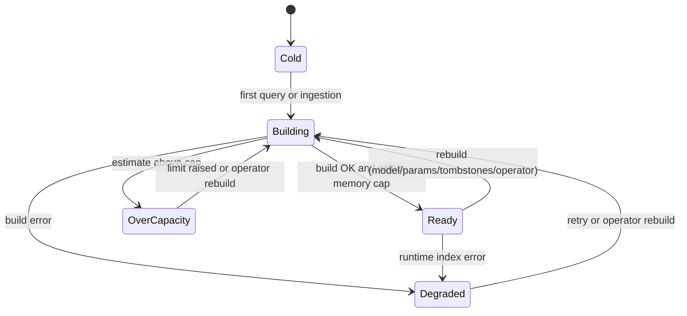

# HNSW Vector Index — Specification

| Field | Value |
| --- | --- |
| Status | Draft — ready for review |
| Request | "prepare HNSW" (architecture/production requirement) |
| Date | 2026-11-02 |
| Scope | RAG retrieval: `/v1/rag/search`, `/v1/rag/query`, ingestion, deletion, RAG settings, monitoring |
| Code changes | None in this task; this document only |

## 1. Summary

Replace the current exhaustive cosine scan used by RAG retrieval with an in-memory,
pure-Go HNSW (Hierarchical Navigable Small World) index built and maintained per
project. The index is a derived cache over the vectors already stored in SQLite:
it is rebuilt from `rag_chunks` after a restart, updated synchronously on
ingestion and deletion, and always falls back to the existing exact scan when it
is cold, unavailable, over its memory budget, or returns fewer results than
requested. Every fallback is visible to callers (`degraded`) and in monitoring.

The target corpus is **≤ 10 000 chunks per project**, the dependency constraint is
**pure Go / `CGO_ENABLED=0`**, the quality target is **≥ 99% recall@k**, and the
driving motivation is an **architectural/production requirement** rather than a
measured latency crisis. The spec therefore prioritizes correctness, isolation
and observability over aggressive performance tuning.

## 2. Current Implementation (baseline)

Retrieval today is exact brute force:

- `application/rag/query.go` — `search` loads **all** chunks of the project via
  `ChunkRepository.ListByProject`, filters them with `compatible(chunks, model,
  width)` so vectors from different embedding spaces are never mixed, calls
  `domainrag.RankChunks`, and returns the result.
- `domain/rag/search.go` — `CosineSimilarity` computes the cosine on the common
  prefix of two vectors (0 for an empty/zero vector); `RankChunks` scores every
  compatible chunk, stable-sorts descending and keeps at most `topK`
  (`DefaultTopK = 4`, `MaxTopK = 20`).
- `infrastructure/rag_chunk_store.go` — chunks are JSON payloads in the
  `rag_chunks` SQLite table (vector included under `$.vector`); `ListByProject`
  selects every payload for the project; `ReplaceForDocument` atomically
  deletes then inserts a document's chunks; `DeleteByDocument` removes them.
- `application/rag/ingest.go` — extraction → chunking → embedding →
  `docs.Create` → `chunks.ReplaceForDocument`; `DeleteDocument` deletes chunks
  then the document row.
- `domain/rag/settings.go` — per-project `Settings` (`embedding_model`,
  `top_k`, `chunk_size`, `chunk_overlap`, `system_prompt`), validated and
  persisted as JSON in `rag_settings`; missing fields are filled by
  `Normalize`/`DefaultSettings`.
- `handlers/rag/query.go` — `/v1/rag/query` and `/v1/rag/search` request/response
  shapes; `web/rag.go` + `web/templates/rag.html` — the French RAG settings page
  and test bench.
- `README.md` documents the current behaviour as "cosine-similarity retrieval in
  SQLite"; `docs/openapi.yaml` describes the RAG schemas.

Repo constraints that shape the design:

- DDD/hexagonal layering: `domain` imports no project package; `application`
  depends on domain ports; `infrastructure` implements ports; `handlers`/`web`
  are delivery; explicit wiring in `app.go` / `app_server.go` / `wiring.go`.
- Production files ≤ 300 lines, functions ≤ 40 lines, ≤ 3 nesting levels
  (`tools/caps`, enforced by `make caps` and CI).
- `CGO_ENABLED=0` builds; the runtime image is `debian:bookworm-slim`; no new
  external service; SQLite is the single persistence file.
- No ANN library, vector extension or HNSW code exists today (confirmed against
  `go.mod`, the Dockerfile and the infrastructure tree).

## 3. Goals and non-goals

### Goals

1. Retrieve RAG passages through an HNSW graph instead of scanning every chunk.
2. Keep the exact cosine search as the correctness backstop and degradation path.
3. Make ingestion changes visible to the very next search (strong freshness).
4. Expose index state, build/query metrics and rebuild controls to operators.
5. Enforce a per-project memory budget so one project cannot exhaust the process.
6. Preserve current API semantics, tenancy and error taxonomy (`top_k` 1–20,
   model/width compatibility, project scoping).
7. Ship pure Go, no CGO, no new external dependency or service.

### Non-goals

- Approximate retrieval for non-RAG endpoints (the embeddings tester stays as is).
- Distributed or shared index across multiple gateway instances (single-process
  assumption already implied by the SQLite deployment).
- Persisting the graph to disk/SQLite (rebuild from chunks instead).
- Replacing SQLite as the source of truth for vectors or passages.
- Automatic CI recall gating (verification is manual, see §9).
- Tuning for corpora far above 10k chunks per project (revisit if re-scoped).
- A feature flag / opt-in toggle: HNSW is always the primary path.

## 4. Interview decisions (decision log)

| # | Question | Decision |
| --- | --- | --- |
| 1 | Target corpus scale | **≤ 10k chunks per project** |
| 2 | Dependency constraint | **Pure Go only, `CGO_ENABLED=0`, no new dependency** |
| 3 | Accuracy target | **≥ 99% recall@k** vs exact search |
| 4 | Motivation | **Architecture/production requirement** |
| 5 | Build timing | **Synchronously on ingestion** into the live graph |
| 6 | Restart persistence | **Rebuild from SQLite chunks** (graph is a derived cache) |
| 7 | Freshness | **Immediately after the write**: upload/delete response implies index updated |
| 8 | Index gating | **Always use HNSW**, even for small projects (no size threshold) |
| 9 | Partitioning | **One graph per project** (single embedding model assumed per graph) |
| 10 | Deletion | **Tombstone + filter at query time**, rebuild when tombstones grow |
| 11 | Parameter config | **Per-project RAG settings** (UI + API) |
| 12 | Failure behaviour | **Fall back to exact scan and flag degradation** |
| 13 | Defaults (M, efConstruction, efSearch) | **Benchmark first, decide later**; provisional values in §8 |
| 14 | Cold start after restart | **Exact scan, build in background**, flagged as degraded until ready |
| 15 | Recall verification | **Manual verification only** (no automated recall gate) |
| 16 | Observability | **All:** build time, query latency, memory/nodes/tombstones, recall samples, degradation events |
| 17 | Operator controls | **RAG settings page + API endpoints** |
| 18 | Memory budget | **Cap per project** (default proposal: 64 MB), serve exact when exceeded |

Two answers need an explicit reconciliation in the design:

- **Always HNSW vs. ≤ 10k chunks.** At this scale exact search is already fast
  (10k × 384 dims ≈ 3.8M multiply-adds per query). HNSW is therefore introduced
  for architectural reasons; benchmarks may show little or no latency win on
  small projects. Accepted, provided the fallback and metrics make any
  regression observable.
- **Manual recall verification vs. "recall samples" observability.** No test or
  CI job enforces 99% recall. Monitoring records degradation events and,
  optionally, sampled exact-vs-ANN overlap for human inspection; the formal
  recall check is the manual benchmark in §9.

## 5. Proposed architecture

### 5.1 Placement in the hexagonal layout

- **Domain** (`domain/rag/index.go`): the `ChunkIndex` port, index state and
  status value objects. No I/O, no concurrency primitives beyond interface
  contracts.
- **Application** (`application/rag/`): orchestration. `query.go` asks the index
  first and falls back to `ChunkRepository` + `RankChunks`; `ingest.go` upserts
  after persistence; `service.go` receives the index port through the
  constructor; `settings.go`/`domain/rag/settings.go` carry the new parameters.
- **Infrastructure** (`infrastructure/ragindex/`): the pure-Go HNSW graph,
  per-project manager, lifecycle, tombstones and memory accounting. It depends
  on `ChunkRepository` only to rebuild from stored vectors.
- **Delivery**: `handlers/rag/index.go` (status/rebuild API), additive fields in
  `handlers/rag/query.go`, `web/rag.go` + `web/templates/rag.html` (settings and
  status card), routes in `web/server.go`.
- **Composition root**: `app.go` / `wiring.go` construct the index manager with
  the chunk store and inject it into the RAG service.

The graph is an adapter, not domain logic: the domain keeps ranking rules
(`CosineSimilarity`, `RankChunks`, `MaxTopK`) and the fallback ordering.

### 5.2 Port

```go
// domain/rag/index.go (illustrative, not final code)
type IndexState string

const (
    IndexCold         IndexState = "cold"
    IndexBuilding     IndexState = "building"
    IndexReady        IndexState = "ready"
    IndexDegraded     IndexState = "degraded"
    IndexOverCapacity IndexState = "over_capacity"
)

type IndexStatus struct {
    ProjectID       string
    State           IndexState
    EmbeddingModel  string
    Dimensions      int
    Nodes           int
    Tombstones      int
    TombstoneRatio  float64
    MemoryBytes     int64
    BuildDurationMS int64
    LastBuiltAt     time.Time
    LastError       string
}

type ChunkIndex interface {
    // Search returns at most k candidates for a ready graph. ok is false when
    // the caller must use the exact scan (cold, building, degraded, model or
    // width mismatch, over capacity).
    Search(ctx context.Context, projectID, model string, query []float32, k int) (hits []RetrievedChunk, status IndexStatus, ok bool)

    // Upsert makes newly stored chunks searchable before it returns.
    Upsert(ctx context.Context, projectID string, chunks []Chunk) error

    // DeleteDocument tombstones the document's chunks before returning.
    DeleteDocument(ctx context.Context, projectID, documentID string) error

    // Rebuild starts a background rebuild from persisted chunks.
    Rebuild(ctx context.Context, projectID string) error

    Status(ctx context.Context, projectID string) IndexStatus
}
```

The exact method set may change during implementation; the invariant is that the
application layer decides fallback, and the adapter never reaches into delivery.

### 5.3 Graph granularity and identity

- **One graph per project**, keyed by `project_id`, per the interview decision.
- Each graph records `embedding_model` and `dimensions` metadata. A graph only
  serves vectors from that model and width.
- Because one project can historically contain chunks from several embedding
  models (the current `compatible` filter exists for that reason):
  - ingestion with a model different from the graph metadata replaces the graph
    with one built from that model's chunks (synchronously, before the upload
    returns);
  - a query whose resolved model differs from the graph metadata serves the exact
    scan, flags degradation, and starts a background rebuild for the query
    model;
  - chunks from other models remain in SQLite and are still excluded by the
    existing compatibility rule. No existing behaviour is lost.
- Node identity is the chunk ID (`<documentID>:<ordinal>`). Re-ingesting the same
  document replaces its nodes: tombstone the previous nodes, then insert the new
  ones in the same synchronous operation.

### 5.4 Graph data structure

Pure Go, no allocations per search beyond result slices and heaps:

- Node: chunk ID, normalized `[]float32` vector, assigned level, adjacency
  `[][]int32` (layer 0 up to `2*M` links, upper layers up to `M`).
- Graph: `entryPoint` node index, `maxLevel`, `nodes []node`, `byID map[string]int32`,
  `tombstones map[string]struct{}`, RNG with a fixed seed for deterministic
  tests.
- Vectors are **L2-normalized on insert and on query**, so the inner product is
  the cosine similarity. The final score returned to callers is recomputed with
  the existing `CosineSimilarity` to preserve exact response semantics.
- Zero-norm vectors are not inserted (they contribute score 0 in exact search);
  this edge case is documented and covered by the fallback path.
- M, efConstruction and efSearch are per-project; `M` and `efConstruction`
  determine graph shape, `efSearch` is a query-time parameter.

### 5.5 Insert algorithm

Standard HNSW insertion:

1. Draw a level from the geometric distribution (`mL = 1 / ln(M)`).
2. Greedy descend from the entry point through layers above the new node's
   level.
3. At each layer from `min(level, maxLevel)` down to 0, search with
   `efConstruction`, select up to `M` nearest candidates, and add bidirectional
   links.
4. Prune each neighbor list to its cap (`2*M` at layer 0, `M` above), keeping the
   closest neighbors.
5. Update `entryPoint`/`maxLevel` when the new node's level is higher.

Determinism: the level generator is seeded per graph (configurable seed in tests)
so recall tests and debugging are reproducible.

### 5.6 Query algorithm

1. Normalize the query vector and reject a zero vector with the exact-scan path.
2. Greedy descent from the entry point to layer 0, then best-first search over
   layer 0 with a candidate list of `max(efSearch, top_k)`.
3. Over-fetch `max(efSearch, 2*top_k)` candidates, drop tombstoned nodes, keep
   the `top_k` highest inner products, recompute exact cosine scores.
4. If the index is not ready/matching, or fewer than `top_k` candidates survive,
   run the existing exact scan (`compatible` + `RankChunks`) and mark the
   response `degraded=true`.

`top_k` remains bounded by `MaxTopK = 20`; `efSearch` is clamped at query time to
at least `top_k` even if the stored setting is lower.

### 5.7 Lifecycle and consistency



- **Restart**: no eager warmup, no persistence. The graph starts `cold` and is
  rebuilt from `rag_chunks` in the background on first need. Queries served
  before readiness use the exact scan and return `degraded=true`; they never
  block on the build.
- **First query**: single-flight background build per project; subsequent
  queries while building continue to use the exact scan and flag degradation.
- **Ingestion**: waits for any in-flight build, then inserts synchronously. The
  next query must see the new chunks. If no graph exists, ingestion builds it
  synchronously from the project's stored chunks for the current model plus the
  new chunks, then swaps it in.
- **Deletion**: tombstone the chunk IDs synchronously before `DeleteDocument`
  returns; the next query already excludes them. Once
  `tombstones / nodes >= hnsw_tombstone_rebuild_ratio`, enqueue a background
  rebuild.
- **Rebuild safety**: a rebuild is built off to the side and atomically swapped
  under the manager lock; readers keep using the previous graph until the swap.
  A failed rebuild leaves the previous graph (if any) and marks the project
  degraded.
- **Settings changes**: `M`/`efConstruction` invalidate the graph and trigger a
  rebuild; `efSearch`, tombstone ratio and memory cap apply immediately.
  Changing the embedding model follows §5.3.
- **Context**: background builds use the process lifetime context, not a
  request context, so a client disconnect does not abort an index build.

### 5.8 Concurrency

- Manager: `map[projectID]*projectIndex` guarded by `sync.RWMutex`, plus a
  single-flight map (`map[string]chan struct{}`) so only one build runs per
  project. No new dependency.
- Each `projectIndex` owns a `sync.RWMutex`: searches take `RLock`, inserts,
  tombstones and swaps take `Lock`.
- Rebuild builds an independent graph without holding the write lock; only the
  pointer swap is serialized. This keeps searches available during rebuilds.
- Race tests (`go test -race`) cover concurrent search/insert/delete/rebuild on
  the same and different projects.

### 5.9 Tombstones and compaction

- Tombstones are chunk IDs filtered at query time; nodes stay linked so the
  graph remains navigable.
- Default rebuild trigger: `hnsw_tombstone_rebuild_ratio = 0.20` (configuration
  range 0.05–0.50).
- A rebuild from SQLite removes all tombstones and restores full node count.
- To guarantee `top_k` completeness, a query that loses results to tombstones
  tops up from the exact scan and flags `degraded=true` for that response.

### 5.10 Memory cap

- Default `hnsw_memory_limit_mb = 64` per project (range 8–1024).
- Estimated footprint at build/insert time:
  - vectors: `4 * dimensions * nodes`
  - adjacency: `4 * nodes * (2*M + M * extraLevels)`
  - metadata/overhead: `~128 * nodes`
- If the estimate exceeds the cap, the graph is not built (or is dropped if
  inserting would exceed it), the project moves to `over_capacity`, and searches
  use the exact scan with `degraded=true`. A metric records the event.
- No LRU eviction across projects: the cap is per project. Projects that never
  exceed their cap keep their graph resident. (Idle-graph eviction is explicitly
  out of scope for this iteration.)
- Raising the setting or an operator rebuild can restore the graph.

### 5.11 Fallback and degraded mode

The exact scanner remains the source of correctness:

- Fall back for: cold/building index, model or width mismatch, over capacity,
  index build/search error, fewer than `top_k` results after tombstone
  filtering.
- The response keeps the same `chunks`/`answer` shape and adds:
  - `"degraded": true|false`
  - `"index_state": "cold|building|ready|degraded|over_capacity"`
- Fallbacks are logged and counted; they never turn a successful query into an
  HTTP error.
- Invalid input (`top_k` out of range, empty question, etc.) keeps its current
  validation errors and is not affected by index state.

## 6. Configuration

New per-project fields in `domain/rag/settings.go`, stored in the existing
`rag_settings` JSON payload (no SQL migration; missing fields get defaults in
`Normalize`):

| Field | JSON | Range | Provisional default | Notes |
| --- | --- | --- | --- | --- |
| `M` | `hnsw_m` | 16–64 | 16 | Links per node; layer 0 cap is `2*M` |
| `efConstruction` | `hnsw_ef_construction` | 40–2000, ≥ M | 200 | Build-time candidate depth |
| `efSearch` | `hnsw_ef_search` | 16–500 | 64 | Clamped to ≥ `top_k` at query time |
| Tombstone ratio | `hnsw_tombstone_rebuild_ratio` | 0.05–0.50 | 0.20 | Rebuild trigger |
| Memory cap (MB) | `hnsw_memory_limit_mb` | 8–1024 | 64 | Per project |
| Recall sample rate | `hnsw_recall_sample_rate` | 0–1 | 0 | Diagnostic only; 0 = off |

Defaults are **provisional** per interview decision #13. The benchmark in §9 must
confirm or replace them before this spec is marked implemented. Existing stored
settings without these keys must normalize to the defaults without a migration.

UI (French, matching the current RAG page): add a collapsible "Index HNSW"
section to `/rag/settings` with the parameters above, a status card
(state, nodes, tombstones, memory, last build, last error) and a "Reconstruire
l'index" button. Validation messages follow the existing French domain error
style.

## 7. API surface

### 7.1 Existing endpoints (additive fields)

`POST /v1/rag/search` and `POST /v1/rag/query` responses gain:

```json
{
  "chunks": [ ... ],
  "total": 3,
  "degraded": false,
  "index_state": "ready"
}
```

`/v1/rag/query` adds the same two fields next to `answer`, `sources`,
`has_context`, `model`. Existing clients that ignore unknown fields are
unaffected; no existing field changes meaning.

### 7.2 New project-scoped endpoints

- `GET /v1/rag/index/status` → `IndexStatus`:
  ```json
  {
    "project_id": "p1",
    "state": "ready",
    "degraded": false,
    "embedding_model": "all-MiniLM-L6-v2",
    "dimensions": 384,
    "nodes": 4210,
    "tombstones": 12,
    "tombstone_ratio": 0.0028,
    "memory_bytes": 18974336,
    "memory_limit_bytes": 67108864,
    "build_duration_ms": 412,
    "last_built_at": "2026-11-02T10:00:00Z",
    "last_error": "",
    "params": {"m": 16, "ef_construction": 200, "ef_search": 64}
  }
  ```
- `POST /v1/rag/index/rebuild` → `202 Accepted` with the current status; the
  rebuild runs in the background (single-flight). Use `GET .../status` to poll.
- Authentication/authorization follows the other `/v1/rag/*` routes (project
  scope from the API key; a key can only see/rebuild its own project).

### 7.3 UI routes

- `GET /rag/settings` — existing page, extended with the index section.
- `POST /rag/index/rebuild` — HTMX form target, returns the refreshed status
  card with a toast on error.
- Settings POST (`POST /rag/settings`) accepts the new fields and preserves
  current validation/error rendering.

`docs/openapi.yaml` gets the new schemas/fields and endpoints; `README.md` gets
a short "HNSW index" section replacing the "cosine-similarity retrieval in
SQLite" wording where it describes the search mechanism.

## 8. Observability

All of the following (interview decision #16), reusing the existing monitoring
and logging patterns:

- **Build duration** per project: last duration, count, failures.
- **Query latency**: p50/p95 for ANN searches and for exact fallbacks,
  separately; a fallback counter.
- **Memory / nodes / tombstones**: current values and per-project status
  (exposed by the status endpoint and the settings page).
- **Degradation events**: every fallback reason (cold, building, mismatch,
  over capacity, error, tombstone top-up), counted by reason.
- **Recall samples**: optional, off by default (`hnsw_recall_sample_rate = 0`);
  when enabled, a small share of queries also runs the exact scan and records
  the overlap with the ANN result. This is diagnostic only — it never changes
  the response and is not an automated pass/fail gate.
- Monitoring page/JSON: add a compact "RAG index" block with the instance-wide
  aggregates; per-project details stay on `/rag/settings` and
  `/v1/rag/index/status`.

## 9. Testing and manual recall verification

### Automated tests

- Graph unit tests (`infrastructure/ragindex/`): synthetic 2-D/8-D points,
  recall against brute force on small deterministic graphs; neighbor caps;
  level assignment determinism; duplicate IDs; zero vectors; single node.
- Query tests: ANN result vs `RankChunks` on a seeded corpus; tombstone
  filtering; top-up behaviour when too few results survive; model/width mismatch
  falls back.
- Lifecycle tests: cold start serves exact and flips to ready after the
  background build; ingestion makes chunks searchable before returning;
  deletion excludes chunks before returning; tombstone ratio triggers rebuild;
  failed build keeps the old graph; over-capacity drops the graph.
- Concurrency/race tests for search vs insert vs delete vs rebuild.
- Web/API tests: new settings round-trip, status/rebuild endpoints, additive
  response fields, auth scoping.
- `go vet`, `gofmt`, `make caps`, `go test -race` remain green.

### Manual recall benchmark (per interview decision #15)

No automated recall gate. Before marking the feature done, run a documented
manual benchmark:

1. Export or generate a representative project corpus (up to ~10k chunks) and
   its embeddings.
2. For each provisional preset (and at least one alternative), compute
   `recall@top_k` against the exact scan for a fixed query set, plus p50/p95
   latency and build time.
3. Confirm ≥ 99% recall@k; record the winning M/efConstruction/efSearch in this
   spec and in the default settings.
4. Repeat on at least two embedding models/widths.

A small reproducibility script under `tools/` is optional; if added it is a
development tool, not part of the runtime.

## 10. Edge cases

| Case | Expected behaviour |
| --- | --- |
| Project has no chunks | Empty result, no graph, `index_state` `cold`/`ready` with 0 nodes; no error |
| Single chunk / k > nodes | Return available nodes; exact semantics |
| Zero-norm vector | Excluded from the graph; exact scan remains the fallback |
| Duplicate chunk ID | Node replaced (tombstone + insert), no duplicate links |
| Re-ingest same document | Old nodes tombstoned, new nodes inserted synchronously |
| Delete during query | Query sees a consistent view (old or new graph); tombstones hide deleted IDs |
| `fg`/`efSearch` < `top_k` | `efSearch` clamped to `top_k` at query time |
| Embedding model switch | Graph rebuilt for the new model; queries for another model use exact scan + degraded |
| Width change (same model name) | Treated as incompatible; rebuild or exact fallback |
| Settings changed (M/efConstruction) | Background rebuild; old graph serves until swap |
| Memory estimate > cap | `over_capacity`; exact scan + degraded; no crash |
| Build error | Old graph kept or exact scan; `degraded`; error logged/counted |
| Cold start | Exact scan immediately; background build; degraded until ready |
| Two gateway instances on one SQLite file | Each builds its own graph (wasteful but correct); documented as unsupported topology |
| Client disconnect during query | Request context cancellation affects only that query; background builds continue |
| `top_k` > 20 / invalid | Existing validation errors unchanged |

## 11. Acceptance criteria

1. A chunk ingested via `POST /v1/rag/documents` is retrievable by the next
   `/v1/rag/search` without a restart, and no `degraded` flag is set once the
   graph is ready.
2. A deleted document's passages never appear in a subsequent search.
3. With a ready graph, `/v1/rag/search` and `/v1/rag/query` use the ANN path
   (`index_state=ready`, `degraded=false`) and return the same top-k ordering as
   exact search on the benchmark corpus.
4. Any index failure/cold state produces exact results and
   `degraded=true`, never a 5xx.
5. After restart, the first query returns exact results promptly and the graph
   becomes ready in the background; status reflects both transitions.
6. `GET /v1/rag/index/status` and `POST /v1/rag/index/rebuild` are project
   scoped and documented in `docs/openapi.yaml`.
7. The per-project memory cap is enforced: exceeding it yields `over_capacity`
   plus exact fallback, with a metric/log entry.
8. Tombstones are filtered immediately; crossing the configured ratio triggers
   a rebuild that returns the node count to the live chunk count.
9. New settings round-trip through the UI/API, normalize old stored settings,
   and validate the documented ranges.
10. `gofmt`, `go vet`, `make caps`, `go test -race ./...` pass; production files
    stay ≤ 300 lines and functions ≤ 40 lines.
11. The manual benchmark records ≥ 99% recall@k and locked defaults are written
    back into this spec.

## 12. Implementation outline (proposed, not created)

| File | Responsibility |
| --- | --- |
| `domain/rag/index.go` | `IndexState`, `IndexStatus`, `ChunkIndex` port |
| `domain/rag/settings.go` | New settings fields, defaults, normalization, validation |
| `application/rag/query.go` | ANN-first retrieval, exact fallback, `degraded`/state propagation |
| `application/rag/ingest.go` | Sync upsert after persistence, replacement tombstones |
| `application/rag/service.go` | Inject the index port |
| `application/rag/settings.go` | Apply new settings |
| `infrastructure/ragindex/graph.go` | Node/graph structures, normalization |
| `infrastructure/ragindex/insert.go` | Level assignment, links, pruning |
| `infrastructure/ragindex/search.go` | Greedy descent, efSearch, tombstone filtering |
| `infrastructure/ragindex/manager.go` | Per-project lifecycle, single-flight, locks, cap, status |
| `handlers/rag/index.go` | Status/rebuild endpoints |
| `handlers/rag/query.go` | Additive `degraded`/`index_state` fields |
| `web/rag.go`, `web/templates/rag.html`, `web/server.go` | Settings UI, status card, rebuild route |
| `wiring.go`, `app.go` | Construct and inject the index manager |
| `docs/openapi.yaml`, `README.md` | Document fields, endpoints, behaviour |
| `tests/`, `infrastructure/ragindex/*_test.go` | End-to-end and algorithm tests |

## 13. Risks and open decisions

| Risk | Mitigation |
| --- | --- |
| At ≤ 10k chunks, exact search is already fast; HNSW may not improve latency and may regress small projects | Benchmark before locking defaults; keep the fallback; isolate the adapter; report both paths |
| In-repo HNSW is non-trivial and easy to get subtly wrong | Deterministic RNG, synthetic recall tests, race tests, manual benchmark, ≤ 300-line modules |
| Tombstones erode recall and memory | Ratio-based rebuild, top-up via exact scan, status visibility |
| One graph per project conflicts with mixed embedding models | Pinned model/width metadata, synchronous rebuild on model change, exact fallback otherwise |
| Recall target is not enforced automatically | Manual benchmark checkpoint and optional sampled recall metric; revisit if this becomes a release blocker |
| Memory estimate formula underestimates real usage | Measure actual heap in benchmark, tune overhead constant, keep the cap advisory but enforced |
| Synchronous ingestion builds can block uploads | Acceptable at ≤ 10k chunks; measure build time; if it regresses, revisit async ingestion (would conflict with immediate freshness) |
| Cold starts always show `degraded` | Expected and documented; status/UI make it explicit |

Still open:

1. Final M/efConstruction/efSearch after the benchmark (provisional values in
   §6 are not commitments).
2. Whether a well-maintained pure-Go HNSW library becomes acceptable later;
   current decision is in-repo, no new dependency.
3. Exact wording/placement of the French UI labels and whether the index card
   lives inside the settings form or beside it.
4. Whether to retain sampled recall data in a bounded in-memory ring, logs, or
   only aggregate counters.
5. Whether `GET /v1/rag/index/status` should also be available to master-scope
   keys across projects (current proposal: same project scope as other RAG
   routes).
